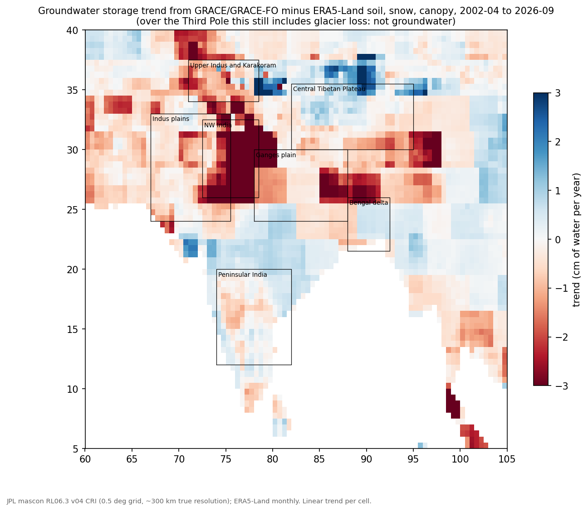

# South Asia groundwater

Groundwater storage change over South Asia and the greater Third Pole from GRACE and GRACE-FO (2002 to the latest
month), with the other water stores removed, regional trends, and plans for downscaling to 1-10 km against
satellite and well data, back-casting before 2002, and scenarios. See `docs/plan.md`.

First results (2002-04 to 2026-09, Theil-Sen trend, cm of water per year): NW India -3.7, Ganges plain -1.2, Indus
plains -1.0, Bengal delta -0.2. Over the Third Pole the signal still includes glacier mass loss and is not
groundwater until glaciers are removed (step 02).

Data: NASA JPL GRACE/GRACE-FO mascons RL06.3 v04 CRI (PO.DAAC); ECMWF ERA5-Land monthly (Earth Engine).
