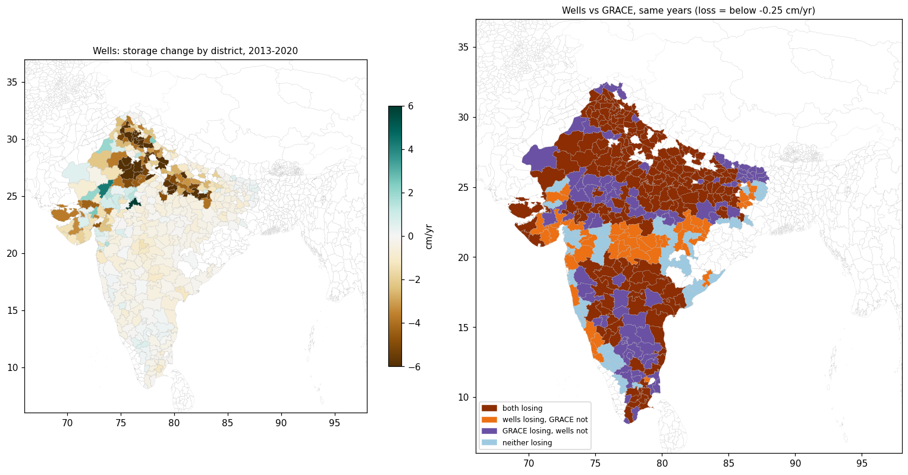

# South Asia groundwater

Groundwater storage change over South Asia and the greater Third Pole from GRACE and GRACE-FO (2002 to the latest
month), with the other water stores removed, regional trends, and plans for downscaling to 1-10 km against
satellite and well data, back-casting before 2002, and scenarios. See `docs/plan.md`.

First results (2002-04 to 2026-09, Theil-Sen trend, cm of water per year): NW India -3.7, Ganges plain -1.2, Indus
plains -1.0, Bengal delta -0.2. Over the Third Pole the signal still includes glacier mass loss and is not
groundwater until glaciers are removed (step 02).

Data: NASA JPL GRACE/GRACE-FO mascons RL06.3 v04 CRI (PO.DAAC); ECMWF ERA5-Land monthly (Earth Engine).

## Finer detail: districts and 0.1 degree (steps 08-11)

GRACE resolves about 300 km. Below that, three things were tried and tested against CGWB wells (tutorial:
`notebooks/fine_scale_groundwater.ipynb`):
- Wells by district (383 Indian districts with >= 5 wells, median 20): real detail. In 2013-2020, 205 districts lose
  water by both wells and GRACE, 51 by wells only (local losses GRACE smooths out), 85 by GRACE only.
- Kriged well surface: cross-validated skill near zero against the mean well (rank correlation 0.2-0.3); single-well
  trends are mostly local, so it is shown as a smoothed tendency with its uncertainty.
- Random-forest downscaling of GRACE to 0.1 deg, mass-conserving: R2 0.22-0.27 at 0.5 deg (5 deg blocks held out), but
  the detail inside GRACE cells does not match wells (rank correlation 0.03; -0.001 when trained on wells). Kept as an
  experimental layer, not a result.
All layers are in `outputs/qgis/groundwater.qgz` (groups "Districts: finer detail" and "Fine grids, 0.1 deg").
